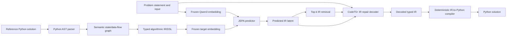
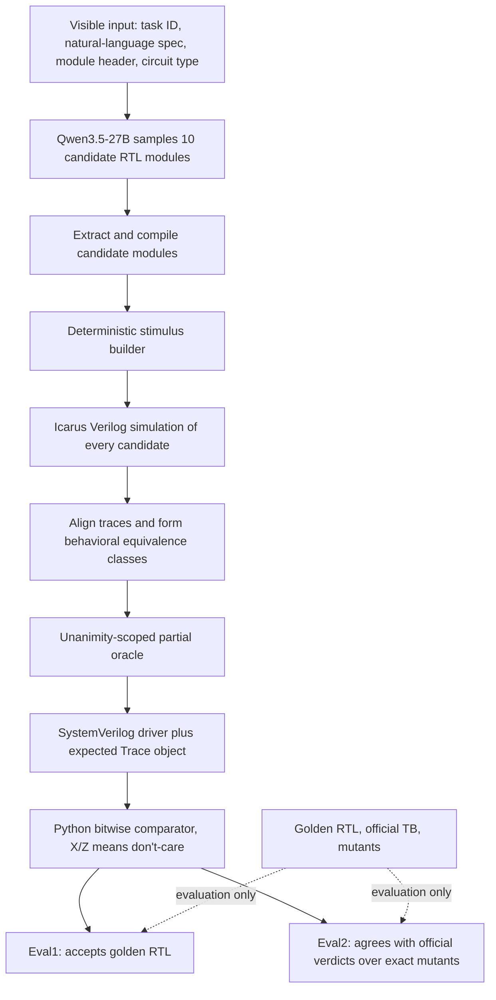

# BIRDI RTL Testbench Generation Research

## Supervisor Progress Report

**Latest operational update (10 October 2026):** The equal-model ConfiBench-Qwen
baseline has 140/156 first task records, with 16 unresolved tasks. All 16 latest
response journals passed CPU replay without new model calls. The last two Kaggle
GPU attempts received CPU only and stopped before model startup. A checkpointed
desktop handoff is being prepared for the user's 32 GB GPU; no desktop GPU run
has been performed yet. Older counts below are dated snapshots, not current
results. See [the desktop resume instructions](desktop/README.md),
[the latest audit](confibench_finish_20261005/RESUME_STATUS.md), and
`confibench_finish_20261005/monitor_state.json` for the collected status.

**Status date:** 24 September 2026  
**Current method:** Divergence-Resolved Testbench Generation (DRTB)  
**Primary benchmark:** VerilogEval / HDLBits, 156 tasks  
**Current model limit:** open models with at most 30B parameters  
**Current generator:** Qwen3.5-27B Q4_K_M through llama.cpp  

---

## 1. Executive Summary

The project began as a JEPA-based Python program-synthesis pipeline. It learned a
mapping from problem descriptions to semantic graph or typed-IR embeddings, retrieved
related solution structures, decoded a repaired IR with CodeT5+, and compiled that IR
deterministically into Python. That work established a useful representation-learning
pipeline, including contrastive and anti-collapse training, but the IR decoder remained
the semantic bottleneck: it could produce valid-looking structures that encoded the
wrong algorithm, especially for unseen compositions.

The project then moved to RTL generation and, finally, to the more measurable problem
of **RTL testbench generation**. The current pipeline does not ask one language model to
write both a DUT and an unquestioned oracle. Instead, it samples ten independent RTL
implementations from the specification, executes them under a deterministic and strong
stimulus schedule, groups them by observed behavior, and constructs a partial oracle.
An output bit is checked only where all candidate implementations agree; candidate
disagreements become `X`/don't-care positions. In the current implementation, the
stimulus is emitted as SystemVerilog while the expected trace and self-check are held by
the Python evaluator. Together these form the executable testbench harness used for
ConfiBench-compatible Eval1 and Eval2.

The complete ten-candidate pool has been generated for all 156 tasks: 1,560 samples,
of which 1,545 contain extracted RTL. On the 33-task development subset available during
method design, unanimity-scoped abstention improved Eval1 from 0.515 to 0.697 and Eval2
from 0.485 to 0.667, with no per-task losses against plurality. These figures are
development evidence, not final held-out results.

A fair equal-model baseline is being run by replacing GPT-4o in the original ConfiBench
pipeline with the same Qwen3.5-27B quantized model used by our method. The two latest
Kaggle sessions are complete. Durable baseline progress is now **78/156 tasks**, with
78 tasks remaining. The full frozen DRTB evaluation and final same-model comparison have
not yet been completed; therefore, no SOTA claim is currently justified.

---

## 2. Research Question

The central question is:

> Can an open model of at most 30B parameters generate RTL testbenches whose golden
> acceptance and hidden-fault detection are competitive with, or better than, strong
> LLM testbench-generation systems, while using executable evidence instead of trusting
> a single generated oracle?

The work evaluates two related hypotheses:

1. A population of independently generated candidate implementations contains useful
   behavioral evidence even when no candidate is guaranteed correct.
2. Candidate disagreement is a measurable uncertainty signal. Restricting assertions
   to unanimous behavior can reduce false rejection of the golden DUT without discarding
   all fault-detection ability.

The fair-win criterion has two parts:

1. Compare DRTB with the published ConfiBench/CorrectBench results where protocols align.
2. Compare DRTB with ConfiBench run using the **same Qwen3.5-27B model**, removing the
   strongest model-capability confound.

---

## 3. Evolution of the Work

### 3.1 Phase A: JEPA for Python code generation

The first pipeline addressed Python program synthesis:

Important clarifications:

- The AST was only the parser used to recover structure from reference code. It was
  never intended to be the final semantic representation.
- The target evolved from loose state/data-flow graph JSON to a typed algorithmic
  intermediate representation with explicit operations, control flow, variables, and
  types.
- Problem and target embeddings used a frozen Qwen encoder.
- The JEPA predictor learned problem-latent to target-latent prediction.
- Training included latent regression, InfoNCE-style contrastive learning, and
  VICReg-style variance/covariance regularization to reduce representational collapse.
- Collapse diagnostics included latent standard deviation, off-diagonal cosine
  similarity, effective rank, and retrieval diversity.
- CodeT5+ 770M was trained to generate or repair typed IR from problem text, retrieved
  IR examples, and the predicted JEPA latent.
- The final code was produced by a deterministic IR-to-Python compiler, not by a final
  code-generating LLM.

What was learned:

- Retrieval worked well for familiar algorithm families such as GCD.
- The final compiler faithfully exposed errors in the decoded structure instead of
  hiding them with a second LLM.
- The decoder often produced syntactically valid but semantically incorrect IR.
- Unseen algorithm composition remained difficult, and the scarce-RTL setting would
  make a large retrieval database harder to build.

This motivated a shift toward a domain where generated artifacts can be executed and
objectively challenged by simulators and formal tools.

### 3.2 Phase B: Multi-agent RTL generation and verification

The next phase used specialized agents:

- RTL generator
- Python behavioral-reference generator
- directed/random test and property generator
- compiler and simulation tools
- independent critic and RTL repair agent

This phase established the importance of compilation, simulation, official testbenches,
metamorphic checks, bounded checking, and mutation-based evaluation. It also tested the
hypothesis that different model families would reduce correlated RTL/reference errors.
The result did not support a simple claim that cross-family agents are always better;
oracle usefulness depends more on correctness, executability, and diagnostic quality
than family diversity alone.

### 3.3 Phase C: ACTIVE-TB family

Several testbench-generation variants were built and evaluated:

| Variant | Main idea | Outcome |
|---|---|---|
| ACTIVE-TB+ | Budgeted adaptive directed/random testing | Established the evaluation and checkpointing framework |
| ACTIVE-TB-X | Temporal, portfolio, and formal extensions | Useful engineering evidence, but not a defensible universal SOTA result |
| ACTIVE-TB-SAFE | Preserve a primary checker and use formal analysis as a shadow channel | 15-task pilot; shadow deployed on 5 tasks, 0 false alarms, 1 extra detected fault |
| ACTIVE-TB-D | Dependency-preserving test-suite distillation | Negative result; did not beat chronological truncation |
| DLR pilots | Ask an LLM to resolve candidate divergence or use alternate reading paths | Both preregistered pilots failed their GO criteria |

The negative ACTIVE-TB-D result was useful. At budget 32, greedy distillation scored
0.3252 versus 0.3385 for simple chronological truncation. However, truncation retained
about 91.9% of CorrectBench's hidden-fault detection using about 55.7% of its cycles.
This is evidence of benchmark-suite redundancy, not evidence that the proposed
distillation method was superior.

### 3.4 Phase D: Current divergence-resolved pipeline

The current DRTB design follows directly from the measured failure modes:

- The stimulus can be made strong and deterministic.
- The main problem is reference correctness.
- A learned local resolver did not reliably beat majority voting.
- Candidate disagreement is still useful as an uncertainty signal.
- More independent candidates can expose shared misreadings that appear unanimous in
  a smaller pool.

---

## 4. Current Pipeline: End-to-End Workflow

### 4.1 Input boundary

Generation and reference construction can see only:

- task identifier
- natural-language specification
- required module header and ports
- combinational/sequential circuit label

The following are isolated until evaluation:

- golden RTL
- official VerilogEval testbench
- exact ConfiBench mutant implementations
- official per-mutant verdicts

This boundary prevents answer leakage into candidate generation or oracle synthesis.

### 4.2 Candidate RTL generation

| Setting | Frozen value |
|---|---|
| Model | Qwen3.5-27B Q4_K_M |
| Runtime | llama.cpp / OpenAI-compatible local server |
| Fine-tuning | None |
| Candidates | 10 per task |
| Tasks | 156 |
| Sampling | temperature 0.6, top-p 0.95, top-k 20, min-p 0 |
| Reasoning | enabled |
| Reasoning budget | 8,000 tokens |
| Answer continuation | up to 3,000 tokens |
| Seeding | deterministic per task/path/sample |

The generation prompt contains the specification and required module interface. It does
not contain the golden design or benchmark testbench. If the model reaches the reasoning
budget without closing its thinking section, a fixed continuation instruction forces a
final answer instead of losing the whole expensive sample.

Generation is complete:

| Statistic | Value |
|---|---:|
| Expected samples | 1,560 |
| Samples present | 1,560 |
| Tasks represented | 156/156 |
| Samples with extracted RTL | 1,545 |
| Samples without usable RTL | 15 |
| Minimum/maximum samples per task | 10/10 |

### 4.3 Deterministic stimulus generation

The driver is generated by code, not by another unconstrained LLM. Its seed is the CRC32
of the task ID, making runs reproducible.

For combinational modules:

- Exhaustively enumerate inputs when total input width is at most 10 bits.
- Otherwise use boundary values, unit vectors, and 400 seeded-random inputs.

For sequential modules:

- Run 8 scenarios of 40 cycles.
- Observe twice per cycle.
- Exercise reset and held-random input patterns.
- Use two-cycle reset setup where the interface exposes reset.

Cost-budgeted marathon traces are added for deep-state behavior:

- all ones: up to 44,000 cycles
- all zeros: up to 2,048 cycles
- held random values: up to 8,192 cycles
- total observed-bit budget capped at 4,000,000

The bit budget prevents wide designs such as cellular grids from timing out while narrow
counters and timers still receive long sequences.

### 4.4 Simulation and trace normalization

Each extracted candidate is compiled and simulated using Icarus Verilog (`iverilog` and
`vvp`). Compile errors, runtime failures, and malformed traces are recorded. Successful
traces are aligned to the modal row count so a malformed candidate cannot define the
reference shape.

Resolution units are chosen conservatively:

- combinational designs: per scenario
- sequential designs with reset: per scenario, because each scenario reinitializes state
- sequential designs without reset: the entire trace, because state crosses scenario
  boundaries and splicing behaviors could create an impossible reference

Within a resolution unit, candidates with identical observable behavior form one class.

### 4.5 Unanimity-scoped partial oracle

The frozen policy is bit-level unanimity:

1. At each observed row and output bit, inspect all usable candidate traces.
2. If every candidate agrees on the bit, retain that value as an assertion.
3. If any candidate disagrees, emit `X`/don't-care for that bit.
4. Do not use golden RTL, mutants, or official verdicts to resolve the disagreement.

This is deliberate abstention, not majority voting. It trades a limited amount of fault
coverage for fewer false assertions against a correct DUT. It is finer-grained than
dropping an entire scenario after the first disagreement.

### 4.6 Current testbench realization

The current implementation realizes a testbench as three cooperating artifacts:

1. A generated SystemVerilog driver containing module instantiation, clocks, reset
   sequencing, the deterministic input schedule, and trace logging to `TBout.txt`.
2. A Python `Trace` object containing the resolved expected output at every observation.
3. The deterministic Python `matches()` checker, which compares DUT and expected traces
   bit by bit and treats expected `X`/`Z` positions as don't-care.

For each DUT, `iverilog` compiles the driver and RTL, `vvp` produces the observed trace,
and `matches()` returns the pass/fail verdict. Thus the evaluated object is an executable
testbench harness, not a prose plan or latent representation.

The current DRTB code does **not yet serialize these three parts into one standalone
self-checking `.sv` file**. That is a packaging gap rather than a change to the measured
oracle: a deterministic final emitter can embed the expected rows and the same X-mask
comparison into SystemVerilog. It should be added before claiming that the deliverable is
a portable standalone testbench.

### 4.7 Evaluation metrics

The evaluator was written to reproduce ConfiBench semantics:

**Eval1: golden acceptance**

- Compile the generated testbench with the golden RTL.
- Simulate it.
- Pass only if the testbench accepts the golden implementation.

**Eval2: hidden-fault verdict agreement**

- Run the generated testbench against every exact benchmark mutant.
- Compare its pass/fail decision with the official VerilogEval testbench's decision.
- Require Eval1 and at least 80% per-mutant agreement.
- Apply ConfiBench's documented `m2014_q3` exception.

Timeouts are 300 seconds for golden simulation and 120 seconds per mutant. The local
validator reproduced the official ConfiBench verdicts for **520/520 development-set
mutants**, establishing metric compatibility.

---

## 5. Why the Current Method Is Different

### Compared with a single-agent testbench generator

- It does not trust a single generated expected-value oracle.
- It derives expected behavior from executable candidate implementations.
- It exposes uncertainty through behavioral disagreement.
- It can abstain locally at a single output bit instead of discarding a whole test.
- Its stimulus and testbench harness construction are deterministic and reproducible.

### Compared with the earlier multi-agent RTL pipeline

- It removes a free-form Python oracle as the sole authority.
- It replaces critic opinion with actual simulation traces wherever possible.
- It does not repair a candidate merely because an LLM critic dislikes it.
- It converts a model population into a partial executable oracle.

### Compared with ConfiBench

- ConfiBench iteratively generates RTL, Python/checker artifacts, testbenches, and debug
  feedback using an LLM-centered pipeline.
- DRTB spends its model budget on a diverse candidate population, then uses deterministic
  stimulus, simulation, behavioral grouping, and uncertainty-aware assertion.
- The comparison will include a same-model ConfiBench run so gains cannot be attributed
  only to using a stronger model.

---

## 6. Experimental Design and Data Split

The 156 tasks are split before final evaluation:

| Split | Tasks | Use |
|---|---:|---|
| Development | 60 | Diagnostics, policy selection, ablations |
| Untouched test | 96 | Final held-out assessment |

Final reporting must keep these splits separate. Any policy selected after inspecting
development golden behavior is frozen before running the 96-task test split.

The main frozen choices are:

- ten candidates per task
- deterministic cost-budgeted stimulus
- unanimity-scoped bit-level abstention
- no DLR learned resolver
- no checklist-path candidate injection
- ConfiBench-compatible Eval1/Eval2

---

## 7. Results Obtained So Far

### 7.1 Stimulus ceiling with a perfect reference

This diagnostic uses golden behavior only to measure whether the stimulus can reach the
benchmark faults. Golden behavior is never used by the deployed pipeline.

| Stimulus | Eval1 | Eval2 | Missed mutants | False rejects |
|---|---:|---:|---:|---:|
| 8 x 40-cycle/random scenarios | 1.000 | 0.917 | 19 | 7 |
| Plus cost-budgeted marathon runs | **1.000** | **0.967** | **6** | 7 |

Interpretation: stimulus quality is high enough that reference correctness, not reach,
is the main bottleneck. One remaining issue is `m2014_q4d`, where the official benchmark
accepts functionally different mutants. A stronger testbench can therefore be penalized
for disagreeing with a weak official oracle.

### 7.2 Interim 33-task development result

| Policy | Eval1 | Eval2 | Don't-care bits | Missed | False rejects |
|---|---:|---:|---:|---:|---:|
| Plurality | 0.515 | 0.485 | 0.0% | 11 | 27 |
| Vote threshold 0.6 | 0.576 | 0.545 | 4.0% | 11 | 23 |
| Vote threshold 0.8 | 0.636 | 0.606 | 7.2% | 13 | 23 |
| **Unanimity** | **0.697** | **0.667** | 10.4% | 13 | 22 |
| Tail abstention | 0.727 | 0.515 | 40.8% | 47 | 21 |
| ConfiBench-4o on same tasks | 0.869 | 0.515 | - | - | - |

Unanimity versus plurality produced +6 wins, 0 losses, and 27 ties per task on both
Eval1 and Eval2. The one-sided sign-test p-value was 0.016. Against ConfiBench-4o on this
subset, unanimity was +0.152 on Eval2 but -0.172 on Eval1.

These are promising development results, but the subset consists of tasks available
during an incomplete generation run and is not representative of the full benchmark.

### 7.3 Candidate-pool-size ablation

On 23 development tasks with both candidate rounds available:

| Candidate pool | Eval1 | Eval2 | Sequential Eval1 | Sequential Eval2 |
|---|---:|---:|---:|---:|
| Stage 3 only, at most 5 | 0.652 | 0.609 | 0.562 | 0.500 |
| Pooled, at most 10 | **0.739** | **0.652** | **0.688** | **0.562** |

The larger pool exposed two misreadings that had appeared unanimous with five samples.
This dev-only ablation motivated freezing ten candidates per task.

### 7.4 Oracle-ceiling diagnostic

On the same interim development population:

| Resolver | Eval1 |
|---|---:|
| Plurality | 0.515 |
| Perfect selector over available candidate behaviors | 0.606 |
| Best single available candidate | 0.606 |
| ConfiBench-4o | 0.869 |

The perfect selector adds only three tasks. This means the dominant failure is that the
candidate pool often contains no correct behavior, not that the resolver selects the
wrong existing behavior.

### 7.5 Failed preregistered improvements

**Divergence-Localized Resolution (DLR).** The model answered all 151 forced questions,
with 34 abstentions. Pipeline accuracy was 0.6623 versus 0.7815 for majority. The delta
was -0.1192 with task-clustered 95% CI [-0.2727, +0.0286]. It failed the preregistered
criterion and was excluded.

**Diverse reading/checklist path.** It fixed 2 of 6 target tasks; the criterion required
at least 3. It was excluded.

**ACTIVE-TB-D distillation.** At budget 32, greedy distillation scored 0.3252 versus
0.3385 for simple truncation. It was not claimed as an improvement.

These negative results are retained because they narrow the research direction and
prevent post-hoc selection of attractive but unsupported methods.

---

## 8. Equal-Model ConfiBench Baseline

### 8.1 Purpose

Published systems often use different models, prompts, budgets, and sample counts. To
isolate pipeline contribution, the original ConfiBench code is being run with the same
Qwen3.5-27B Q4_K_M weights used by DRTB.

### 8.2 What remains unchanged

- ConfiBench prompts and `pychecker` flow
- TBcheck discriminator
- debug maximum 3
- iteration maximum 10
- 20 RTL candidates per task
- `e_rank_super` threshold 0.15 and K=8
- multibench masks with minimum 2 testbenches and ratio 0.8
- ConfiBench's own Eval1/Eval2 calculation

### 8.3 Necessary endpoint changes

- GPT/OpenAI endpoint replaced with a local llama.cpp server.
- Model replaced with Qwen3.5-27B Q4_K_M.
- Thinking disabled because ConfiBench prompts expect direct answers.
- Default sampling set to temperature 0.7, top-p 0.8, top-k 20.
- Maximum output per call is 8,192 tokens.
- No GPT-4o-generated RTL population is reused.

### 8.4 Current status

Both latest Kaggle runs are complete. The direct checkpoint layout was verified remotely:

| Shard | Completed tasks | Remaining tasks |
|---|---:|---:|
| 0 of 4 | 15/39 | 24 |
| 1 of 4 | 17/39 | 22 |
| 2 of 4 | 18/39 | 21 |
| 3 of 4 | 28/39 | 11 |
| **Total** | **78/156** | **78** |

The current runs prove that checkpoint restoration works end-to-end. Shard 2 restored
10 tasks before running, and shard 3 restored 19. Results are stored directly under
`resume_saves`, checked against an expected count before model startup, and verified by
the scheduler against Kaggle's remote file listing before a kernel is launched.

This baseline is **not yet complete**, so its aggregate Eval1/Eval2 must not be reported
as a final result.

**26 September scheduling update:** after weekly quota reset, the 78 unfinished tasks
were repartitioned into ten checkpointed shards and launched concurrently across all
five configured Kaggle accounts, two kernels per account. All ten were confirmed
`RUNNING`. This changes only scheduling; the baseline method and evaluation remain
frozen.

---

## 9. Kaggle Reliability Engineering

Long-running evaluation exposed several infrastructure failures that could silently
invalidate progress. They were fixed as part of the research tooling:

1. The Kaggle CLI can return exit code 0 even when a kernel push is rejected. The helper
   now requires the explicit success message.
2. Eight llama-server slots gave only about 16K context per slot and caused context and
   disk failures. The baseline now uses four slots with about 32K context per request.
3. llama.cpp build artifacts are removed after startup to reclaim disk.
4. Completed task directories are compacted periodically while preserving result and
   diagnostic files.
5. An empty ConfiBench `saves/` directory initially blocked archive extraction.
6. Kaggle automatically expanded nested ZIP files, so a ZIP-based resume path was not
   visible at runtime.
7. Checkpoints are now published as direct files under `resume_saves/`.
8. `XJ_BOUNDARY.json` records the exact expected checkpoint count.
9. Runtime hard-fails if the restored count differs.
10. The scheduler waits until the remote dataset listing exposes the exact count before
    launching, preventing a kernel from mounting a stale dataset version.

No API token is embedded in notebooks, datasets, bundles, logs, or this report.

---

## 10. What Can and Cannot Be Claimed Today

### Supported claims

- The complete 10-candidate Qwen3.5-27B pool exists for all 156 tasks.
- The local evaluator reproduces 520/520 official development mutant verdicts.
- The frozen stimulus has a 0.967 development Eval2 ceiling with a perfect reference.
- On the 33-task development subset, unanimity-scoped abstention significantly improved
  both Eval1 and Eval2 over plurality without per-task regression.
- Increasing the candidate pool from at most 5 to at most 10 improved the 23-task
  development ablation.
- DLR, checklist prompting, and dependency-preserving distillation did not satisfy their
  preregistered improvement criteria.
- Direct-file Kaggle checkpointing now works end-to-end.

### Claims not yet supported

- That DRTB beats ConfiBench on the full 156-task benchmark.
- That DRTB beats the same-model ConfiBench-Qwen baseline.
- That the method is state of the art.
- That development gains will transfer unchanged to the 96 untouched tasks.
- That unanimity is optimal for another benchmark or model family.

The final report must preserve this distinction.

---

## 11. Current Limitations

1. **Shared candidate errors.** If all ten candidates implement the same wrong behavior,
   unanimity treats it as confident and asserts it.
2. **Candidate quality ceiling.** A resolver cannot recover behavior absent from the
   candidate pool.
3. **Abstention trade-off.** More don't-care bits improve golden acceptance but can miss
   mutants.
4. **Benchmark-oracle weakness.** Eval2 rewards agreement with the official testbench,
   which can accept incorrect mutants on some tasks.
5. **Single-model family.** Ten samples from one model are diverse but not independent in
   the statistical sense.
6. **Quantization.** Q4_K_M is practical for T4 GPUs but may reduce candidate accuracy.
7. **Compute cost.** Ten long-reasoning candidates and full mutation evaluation are
   expensive.
8. **One baseline run.** The same-model ConfiBench baseline is one stochastic run, whereas
   published ConfiBench-4o aggregates three.
9. **Development tuning.** Unanimity and N=10 were selected using development behavior;
   only the untouched split can establish transfer.
10. **Standalone artifact gap.** DRTB currently evaluates a SystemVerilog driver plus a
    Python expected-trace checker; it does not yet export an equivalent single
    self-checking SystemVerilog file.

---

## 12. Remaining Work

### Immediate execution

1. Finish the 78 remaining ConfiBench-Qwen tasks.
2. Merge and validate all four baseline shards.
3. Run the frozen DRTB pipeline with `--policy unanimity` on all 156 tasks.
4. Report the 60-task development and 96-task test results separately.
5. Compute Eval1/Eval2 overall and by combinational versus sequential class.
6. Report missed mutants, false rejections, don't-care fraction, compile failures, and
   per-task errors.
7. Add and regression-test a deterministic standalone SystemVerilog emitter that embeds
   the frozen driver and expected trace without changing any task verdict.

At the measured baseline throughput, 78 remaining tasks correspond roughly to 66-74
Kaggle GPU-session hours. Parallel accounts reduce wall-clock time but not total GPU time.

### Final statistical analysis

1. Paired task-level DRTB versus ConfiBench-Qwen differences.
2. Task-clustered bootstrap confidence intervals.
3. Paired win/tie/loss counts and sign tests.
4. Development-to-test transfer analysis.
5. Candidate-count and abstention ablations reported as development evidence only.
6. Error taxonomy: compile failure, no-correct-candidate, shared misreading, excessive
   abstention, insufficient stimulus, and official-oracle anomaly.

### Follow-up research after the frozen run

The best next research direction depends on the final failure distribution:

- If shared misreadings dominate, introduce controlled cross-model or independently
  prompted candidate diversity.
- If correct candidate behavior exists but is masked, improve behavioral selection with
  evidence that does not use golden or mutants.
- If deep-state faults remain unreachable, add coverage-guided or bounded-formal witness
  stimulus generation.
- If abstention loses too much Eval2, learn a calibrated confidence policy on development
  and validate it once on the untouched split.
- If model quality is the limiting factor, repeat candidate generation with a stronger
  open model while keeping the deterministic backend and data boundary unchanged.

These are future experiments, not additions to the already frozen comparison.

---

## 13. Reproducibility Map

| Artifact | Purpose |
|---|---|
| [`PIPELINE_PROGRESS.md`](PIPELINE_PROGRESS.md) | Chronological experiment and Kaggle status log |
| [`BASELINE_CONFIBENCH_QWEN.md`](BASELINE_CONFIBENCH_QWEN.md) | Frozen equal-model baseline protocol |
| [`dirtb/run_pipeline.py`](dirtb/run_pipeline.py) | End-to-end DRTB execution |
| [`dirtb/generate.py`](dirtb/generate.py) | Candidate generation client and sampling |
| [`dirtb/hdl.py`](dirtb/hdl.py) | Interface parsing, deterministic driver, simulation |
| [`dirtb/resolve.py`](dirtb/resolve.py) | Behavioral grouping and reference resolution |
| [`dirtb/abstain_policies.py`](dirtb/abstain_policies.py) | Development abstention ablations |
| [`dirtb/evaluate.py`](dirtb/evaluate.py) | ConfiBench-compatible Eval1/Eval2 |
| [`dirtb/calibrate_golden.py`](dirtb/calibrate_golden.py) | Metric validation and stimulus ceiling |
| [`dirtb/oracle_ceiling.py`](dirtb/oracle_ceiling.py) | Generation-versus-resolution diagnostic |
| [`dirtb/kaggle_rotate.py`](dirtb/kaggle_rotate.py) | Credential-safe multi-account scheduling and checkpoint verification |
| [`prepare_stage3_gen.py`](prepare_stage3_gen.py) | Reproducible Kaggle generation bundles |
| [`prepare_confibench_qwen.py`](prepare_confibench_qwen.py) | Equal-model ConfiBench bundles and resume logic |
| [`kaggle_runs/s3gen_n10_final_merged.jsonl`](kaggle_runs/s3gen_n10_final_merged.jsonl) | Complete 1,560-sample candidate pool |
| [`DLR_PREREGISTRATION.md`](DLR_PREREGISTRATION.md) | Localized-resolution preregistration |
| [`DLR2_PREREGISTRATION.md`](DLR2_PREREGISTRATION.md) | Diverse-reading preregistration |
| [`FINAL_BENCHMARK_RESULTS.md`](FINAL_BENCHMARK_RESULTS.md) | ACTIVE-TB-D benchmark and negative result |
| [`ACTIVE_TB_SAFE_FINAL.md`](ACTIVE_TB_SAFE_FINAL.md) | SAFE dual-channel formal-shadow study |
| [`METHOD_FREEZE_v3.json`](METHOD_FREEZE_v3.json) | Frozen artifact hashes for prior SAFE transfer |

---

## 14. Short Supervisor Explanation

We are building an RTL testbench generator that does not blindly trust one LLM-written
oracle. For each specification, an open 27B model generates ten independent RTL
implementations. We run all candidates on the same deterministic input schedule and
assert only the output bits on which every candidate agrees. Disagreements are treated
as explicit uncertainty. The current executable harness combines a SystemVerilog driver
with a Python expected-trace checker and is measured by whether it accepts the golden
design and matches the official benchmark's decisions on hidden mutants. Export to an
equivalent standalone self-checking SystemVerilog file remains an explicit packaging
step.

Development experiments show that unanimity-based abstention materially improves both
golden acceptance and mutation-verdict agreement over majority voting. However, the
held-out full-benchmark run and the fair same-model ConfiBench baseline are still in
progress. Candidate generation is complete, the equal-model baseline is 78/156 tasks
complete, and no final SOTA claim will be made until both frozen evaluations finish.

---

## 15. One-Sentence Contribution Statement

The proposed contribution is an uncertainty-aware, execution-grounded testbench synthesis
pipeline that converts behavioral agreement across independently generated RTL candidates
into a deterministic partial oracle, with strict data isolation and same-model evaluation
against ConfiBench.

## 16. Status Update: 2026-10-04

The older 78/156 progress number above is historical. The canonical same-model
ConfiBench baseline now contains 138/156 task records, not 138 passing tasks.
Eighteen tasks remain unresolved. The October 3 ten-kernel wave consumed about
110.22 total notebook-session hours but produced only two new final records.
This was an execution-design failure: task-level checkpoints could not resume
work within unfinished tasks. GPU launches are held while recovery is validated.

All partial archives and logs are saved locally. New response journals and
iteration-boundary state checkpoints pass CPU-only interruption/replay tests.
After explicit private-publication approval, two CPU-only Kaggle pilot versions
finished on one unresolved task, `ece241_2014_q4`. The first replayed 108 saved
responses after forced interruption and saved nine completed iteration boundaries
through the actual upstream Linux pipeline. The second restored that checkpoint
directly at iteration 10, skipping the nine completed iterations and replaying
only four unfinished-prefix responses per phase. Saved responses remained
byte-identical. Neither run downloaded a model, used GPU execution, or made fresh
model calls.

Both pilots stopped intentionally at the first missing response under a
zero-fresh-call budget. They did not complete the benchmark task: coverage is
still 138/156 records, with 18 unresolved. Recovery is demonstrated on one actual
task, not all remaining tasks; GPU throughput and fresh-generation recovery
remain to be validated with a single capped pilot before further GPU scheduling.
No final SOTA claim or full-baseline completion is justified at this point.

Detailed evidence and limitations:
`confibench_finish_20261003/RECOVERY_AND_RESUME_AUDIT.md`.
